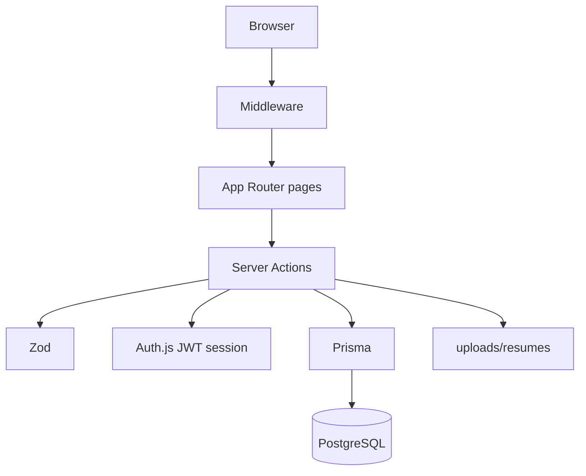

# HireHub

HireHub is a small job board. Candidates search open roles, save a search, and apply with a resume. Employers post jobs and move applications through a short pipeline. Accounts are either a candidate or an employer, and each side has its own dashboard.

## Features

- Public job search. Keyword, city, and employment type come from the URL, so a filtered page can be shared.
- Paginated results, five open roles per page, newest first.
- Saved searches store that same keyword, city, and employment type.
- Candidate applications with a cover letter and a resume file.
- Employer dashboard for posting a job, keeping a draft off the board, and updating application status.
- Email and password sign-in. Middleware and the server actions both check the role.

## Architecture



The browser talks to App Router pages. Mutations go through Server Actions. Auth.js puts the user id and role on a JWT, which the middleware can read without a database query. Prisma talks to PostgreSQL. Resume files are written under `uploads/resumes` and downloaded through an authenticated route.

## Folder structure

```
prisma/                 schema, migration, seed
src/app/                pages and route handlers
src/actions/            server actions for auth, jobs, applications, saved searches
src/components/         forms and the page chrome
src/lib/                validation, search, authorization, uploads
src/auth.ts             Auth.js credentials provider
src/auth.config.ts      JWT callbacks shared with middleware
e2e/                    Playwright flows
tests/unit              Vitest
tests/integration       Vitest against Postgres
```

## Running locally

Use Node.js 20.12 or newer. PostgreSQL is the only service. Docker Compose starts it:

```bash
docker compose up -d
cp .env.example .env
```

Set `AUTH_SECRET` to a long random string (`openssl rand -base64 32`). `AUTH_URL` should match the origin you open in the browser, usually `http://localhost:3000`.

```bash
npm install
npx prisma migrate deploy
npm run db:seed
npm run dev
```

Seeded accounts all use the password `password123`:

| Email | Role |
| --- | --- |
| jordan.hale@example.com | Candidate |
| mira.chen@example.com | Employer, Lumen Labs |
| owen.blake@example.com | Employer, Northwind |

`npm run db:seed` clears the application tables and loads those accounts again.

## Tests

Unit tests cover validation, the search query builder, authorization, and resume paths. Integration tests run the same query against Postgres and check the composite indexes, so they need `DATABASE_URL`.

```bash
npm test
npm run lint
npm run typecheck
```

Playwright drives the board in a real browser. Install Chromium once, reset the database so the seed is in a known state, build, then run the suite:

```bash
npx playwright install chromium
npm run db:reset
npm run build
npm run test:e2e
```

`db:reset` reapplies the migration and runs the seed.

## Design decisions

**Credentials and a JWT.** The board's accounts are email and password. Auth.js stores that kind of session in a JWT rather than in the `Session` table. The token carries the user id and the role, so middleware can send a candidate away from `/dashboard/employer` without querying Postgres. The Prisma adapter and the `Account`, `Session`, and `VerificationToken` models are still wired up, using the column names the adapter expects, so a social provider can be added later without a new schema. `authorize` checks the password itself. The login action also checks it, so a bad password never depends on a particular Auth.js error string.

**Authorization in two places.** Middleware is the redirect. Every server action checks the role again, and resume downloads check that the caller is the applicant or the employer who owns the job. A hidden form post should fail even if the page was never opened.

**Search lives in the URL.** `/?q=engineer&location=Berlin&type=FULL_TIME&page=2` is the whole filter. Empty fields are dropped, and a page past the end is pulled back to the last page. A saved search is a name plus those three fields. Opening it rebuilds the same query string.

**Indexes follow the queries.** Postgres gets a composite index for each list the app actually runs:

- `(status, createdAt)` for open roles, newest first
- `(companyId, status)` for an employer's jobs
- `(location, employmentType)` for the city and type filters, which use equality so that index can apply
- `(candidateId, status)` for the candidate dashboard
- `(jobId, status)` for the applications on one job
- `(userId, createdAt)` for saved searches
- unique `(jobId, candidateId)` so the same person cannot apply twice

Keyword search is a case-insensitive `contains` on the title, description, and company name. That will not use a btree index, and the location filter is an exact city match for that reason. The location box has a datalist of cities already on open roles.

**Resumes stay off the public folder.** The stored file name is the application id plus `.pdf`, `.doc`, or `.docx`. The original name is kept only for the download header, after stripping path characters. The download route resolves the path and refuses anything that escapes `uploads/resumes`. Zod checks the rest of each form. The resume check is size, extension, and MIME type, with a 5 MB cap. The Server Action body limit is 6 MB so the file fits.

**Drafts and closed roles.** A new job can be saved as a draft. Drafts are visible to the employer who wrote them and are omitted from search. Closed roles stay on the employer's dashboard and drop off the public list. An employer can set an application to submitted, reviewing, interview, offer, or rejected. The candidate can withdraw. A withdrawn application is left as-is.

## Stack

Next.js 14 (App Router, Server Actions), TypeScript, PostgreSQL, Prisma, Auth.js, Zod, Tailwind CSS, Vitest, and Playwright.
